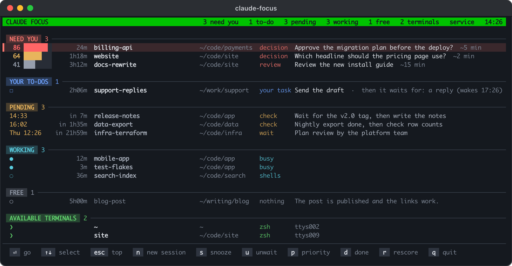
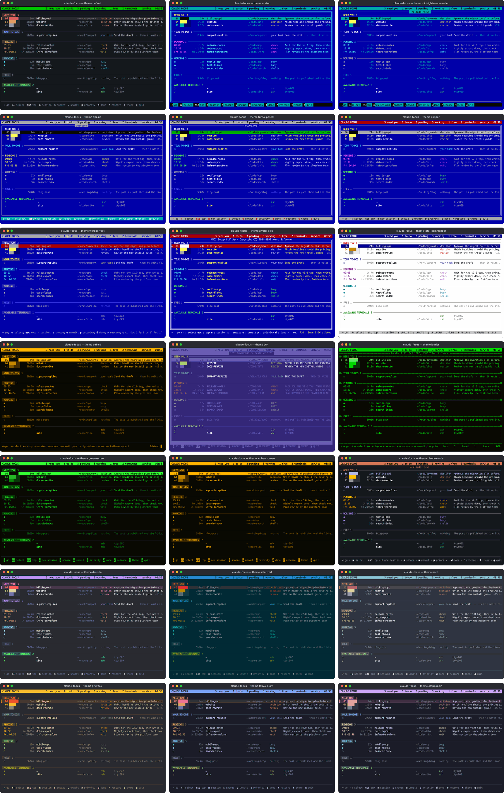

# claude-focus

One priority queue over all your running Claude Code sessions, in
[iTerm2](https://iterm2.com) or [herdr](https://herdr.dev/).

If you run ten or twenty Claude Code sessions at once, a lot of time goes
into finding the one that needs you. claude-focus watches every session,
scores what each one needs from you, and shows them in one list: what needs
you first, then your to-dos, the sessions that wait for something external,
the ones that work, the ones that are done, and your free terminals. Enter
takes you to the selected session's pane. When you answer, the session works
on, and the next one is selected.



It also lets a session wait for something external (a reply, a deploy, a
date) without sitting in your queue. When the time comes or a check command
succeeds, claude-focus types a wake-up message into the session, and Claude
continues by itself.

What it does:

- **One queue** over every Claude Code session, ranked by how much each one
  needs you, with the one-line request it has for you.
- **Scoring** by a headless `claude -p` call on your own Claude Code login,
  or by the much cheaper jev model with a TypeSafe or
  [OpenRouter](https://openrouter.ai) key (see "Scoring").
- **Pending waits**: a session waits for a time or a check command, leaves
  your queue, and is woken up with a message in its prompt.
- **Free terminals**: panes at a bare shell, where a new session starts in a
  folder you pick by typing a few letters.
- **iTerm2**: global hotkeys, a green profile for free panes, and a restore
  of every window after a crash or a restart.
- **herdr**: the queue in herdr's own sidebar, herdr keys to jump to the
  session that needs you most, and no setup in the terminal itself.

## iTerm2 and herdr

claude-focus finds each session's pane, reads its screen, types wake-up
messages and brings panes to the front through the terminal's API: the
iTerm2 Python API or herdr's socket API. Everything else (the queue, the
scoring, the waits) is the same in both.

| | [iTerm2](https://iterm2.com) | [herdr](https://herdr.dev/) |
|---|---|---|
| API | The Python API (turn it on in iTerm2's settings) | herdr's socket (`$HERDR_SOCKET_PATH`, else `~/.config/herdr/herdr.sock`) |
| Finding a session's pane | The pane with the tty of its process | The pane whose foreground runs its process; else the session id that herdr's Claude Code hook reported |
| An empty prompt (safe to type into) | The screen and the cursor position | The screen and its colors: suggestion text is dim, a draft is not |
| Enter on a session | Brings its window to the front and maximizes the pane | Focuses its pane in any workspace and zooms it in its tab |
| Free terminals | Panes with the green `Available` profile | Every pane at a bare shell, no setup |
| Keys from anywhere | Optional global hotkeys: ⌃⌥N (go), ⌃⌥F (focus screen) | herdr keys that setup adds: `prefix+a` (go), `prefix+f` (focus screen) |
| The queue outside the focus screen | — | In herdr's sidebar (pane metadata tokens) |
| The focus screen opens in | A new iTerm2 window | A new herdr tab |
| After a crash or a restart | `claude-focus restore` and `reboot` reopen every window | herdr keeps its panes and resumes the sessions |
| Changes show | Every 3 s | At once (herdr's events), and every 3 s |
| Theme of the focus screen | iTerm2's dark or light theme | macOS's dark or light appearance |

iTerm2 is a terminal of its own. herdr runs in any terminal (Ghostty,
Terminal.app, Warp, iTerm2, ...), so with herdr any terminal works; without
it, only iTerm2 does. Sessions that run inside tmux, in another herdr
session or on a remote machine show without a pane.

### Which terminal

Config `terminal` (`"auto"`, `"iterm"` or `"herdr"`) decides first. With
`"auto"` (the default), a focus screen or command inside an iTerm2 pane uses
iTerm2, and one inside a herdr pane uses herdr. A herdr pane can carry
iTerm2's variables too (when iTerm2 started the herdr server); then herdr
wins.

The background service runs in neither, so it asks both. When only one
runs, it takes that one. When both run, it takes the one that runs more of
the live Claude sessions, by their parent processes: a pane's shell is a
child of iTerm2 or of the herdr server. This needs no API and no
permission. The service looks again every minute and restarts on the other
terminal when your sessions move there. `claude-focus status` says which
terminal it uses, and whether it was detected or set in the config.

## Requirements

- macOS.
- [iTerm2](https://iterm2.com) with its Python API on, or
  [herdr](https://herdr.dev/) (tested with 0.9.5, API protocol 22).
- Python 3.10 or newer.
- [Claude Code](https://claude.com/claude-code) (tested with 2.1.29x to
  2.1.306). claude-focus reads Claude Code's own session files, which are
  not a public API, so a Claude Code update can break it.

This is an early release. It runs every day on one Mac with about 20
sessions; expect rough edges elsewhere, and please open an issue.

## Install

In iTerm2, first turn on its Python API (Settings > General > Magic >
Enable Python API), then run these two commands in iTerm2. In herdr, run
them in one of its panes:

```sh
uv tool install git+https://github.com/nejko/claude-focus
claude-focus setup
```

No uv yet? `brew install uv`, or see [docs.astral.sh/uv](https://docs.astral.sh/uv/).
pipx works too: `pipx install git+https://github.com/nejko/claude-focus`.

`claude-focus setup` does the rest and tells you what it did. You can run it
again at any time; it skips what is done. It:

1. checks for macOS, the terminal and `claude`, and connects to the
   terminal. The first time in iTerm2, macOS asks whether claude-focus may
   control iTerm2: allow it.
2. asks your name, for the messages to sessions
   (`~/.claude-focus/config.json`).
3. adds the prompt hook to `~/.claude/settings.json` (see "Pending waits").
4. adds a short rule to `~/.claude/CLAUDE.md`, so that sessions know how to
   wait (the text is in
   [claude_focus/claude_md_rule.md](claude_focus/claude_md_rule.md)).
5. sets up the terminal:
   - iTerm2: asks whether you want free terminals, adds a green iTerm2
     profile and lets claude-focus switch panes to it (see "iTerm2").
   - herdr: offers herdr's Claude Code integration (`herdr integration
     install claude`), and two herdr keys in `~/.config/herdr/config.toml`
     (see "herdr").
6. starts the background service, a LaunchAgent that starts at login and
   restarts after a crash or when the terminal restarts. It gets the PATH of
   the shell you run setup from: the scorer needs `claude`, and your check
   commands need their tools.
7. opens the focus screen in a new iTerm2 window or herdr tab. Keep it open.

Before it changes `settings.json`, `CLAUDE.md` or herdr's `config.toml` the
first time, setup keeps a copy next to it (`.before-claude-focus`).
`claude-focus setup --dry-run` shows what it would do; `--yes` takes the
defaults without asking.

The scorer follows the rules in `~/.claude-focus/priorities.md`. Edit them
to say what matters to you.

### Upgrade

`uv tool upgrade claude-focus && claude-focus setup` (setup restarts the
service on the new code).

### Uninstall

`claude-focus uninstall` removes the service, the hook, the CLAUDE.md rule,
the green iTerm2 profile and the herdr keys, and keeps your state in
`~/.claude-focus` (`--purge` removes it too). Then
`uv tool uninstall claude-focus`.

### Development

Clone the repo, `python3 -m venv .venv &&
.venv/bin/pip install -e '.[jev]'`, and run `.venv/bin/claude-focus` (or
link `bin/claude-focus` onto your PATH).

## Commands

```sh
claude-focus                  # the focus screen (in its own iTerm2 window or herdr tab)
claude-focus setup            # set everything up, or check it again
claude-focus list             # print the queue once
claude-focus go               # go to the session at the top of the queue
claude-focus show             # bring the focus screen to the front, or open one
claude-focus pending ...      # from inside a session: wait for something external
claude-focus restore          # iTerm2, after a crash: open the sessions of the last iTerm2 run again
claude-focus reboot           # iTerm2, before a planned restart: save the layout, stop working sessions
claude-focus cost             # scorer calls and spend per day
claude-focus status           # which terminal, and is the service running?
claude-focus uninstall        # undo setup
```

`go` and `show` work in both terminals; the herdr keys run them.

## The focus screen

The sections, top to bottom:

- NEED YOU: the session waits for your answer, ranked by priority.
- YOUR TO-DOS: the session waits for something external and left you a
  task meanwhile (send a draft, sign, pay). Oldest first.
- PENDING: the session waits for a time or a check, or you snoozed it.
  Next wake-up first.
- WORKING: the session is busy, or its background shells still run.
- FREE: nothing is needed; you can close or reuse the terminal.
- AVAILABLE TERMINALS: free panes, ready for a new session (see "Free
  terminals").

Every section uses one grid, so each column is always in the same place: a
lead (in NEED YOU the priority as a number and a bar whose length is the
priority; in PENDING the wake time), an age (how long it has waited for you,
worked or slept; in PENDING the time until it wakes), the name, the folder
the session runs in, a kind (decision, action, check, wait, snoozed, busy,
shells, ...) and the text. The folder column is as wide as the longest
folder on the screen, at most 40 columns; a longer folder keeps its end.
Windows narrower than 110 columns drop the folder column (WORKING then shows
the folder as its text), and below 100 columns also the kind column.

Each section has its own color. A priority of 80 or more is red, of 60 or
more amber, and the rest grey. Alerts are red: a wake-up that could not be
typed, a duplicate window, a session without a pane. What needs you is
bright, PENDING and WORKING are softer, and FREE is grey. The selected row
has a tinted background and a ▌ at the left. The screen uses 24-bit color
and follows the terminal's dark or light appearance: iTerm2's, or macOS's
in herdr.

### Themes

`t` shows the next theme on the screen at once, and `T` the one before
(the arrow keys step too). The key line says which theme it is. Enter
keeps it in the config (`"theme"`), and Esc goes back to the theme you had.

| Theme | What it imitates |
|---|---|
| `default` | The look described above, on the terminal's own background |
| `norton` | Norton Commander: light cyan on blue in a double-line frame, a black-on-cyan bar, the `1Help` key bar |
| `midnight-commander` | Midnight Commander: light grey on blue in single-line frames, the panel title and bar black on cyan |
| `qbasic` | Microsoft QBasic: light grey on blue in a window titled `Untitled`, keys as `<n=session>` on a cyan status line |
| `turbo-pascal` | Borland Turbo Pascal 7: yellow on blue in a white double-line window `FOCUS.PAS`, the bar black on green, red key names |
| `clipper` | A Clipper application (`SET COLOR TO W+/B,N/W`): white on blue, a double-line box, the bar and status line black on grey |
| `wordperfect` | WordPerfect 5.1: light grey on blue, a block light grey on red, `Doc 1 Pg 1 Ln 1" Pos 1"` at the bottom right |
| `award-bios` | Award BIOS setup: yellow on blue in a white box titled CMOS Setup Utility, a `►` and a white-on-red bar |
| `total-commander` | Total Commander on classic Windows: black on white, the title and cursor bar white on navy, grey key buttons |
| `cobiss` | COBISS/OPAC on the amber DEC VT420/VT510 terminals of Slovenian libraries, with the prompt `Izbira:` (a reconstruction) |
| `c64` | Commodore 64: light blue capitals on blue in a thick border, `**** COMMODORE 64 BASIC V2 ****` |
| `ladder` | The game Ladder on a Kaypro II: one P31 green, floors `=`, walls `\|`, ladders `H`, Lad `p` at the selected row |
| `green-screen`, `amber-screen` | A monochrome monitor: one phosphor color in four strengths, reverse video bars |
| `claude-code` | Claude Code's own colors (dark or light): claude orange, a rounded box titled `✻ claude-focus`, the selected row in its suggestion blue with `❯` |
| `dracula`, `nord`, `tokyo-night` | The color schemes, each on its own background |
| `solarized`, `gruvbox`, `catppuccin` | The color schemes, dark or light with the terminal (Catppuccin: Mocha or Latte) |

The retro themes paint their own background, so they look the same in a
dark and a light terminal. Their colors come from the programs where a
source exists: the MS-DOS 6.0 source for QBasic, `TURBO.EXE` 7.01 for Turbo
Pascal, WordPerfect's default Setup colors, a screenshot for Award BIOS,
the Pepto palette for the C64, `LADDER.COM` 1.30 for Ladder, and Claude
Code 2.1.306 for Claude Code. For COBISS, IZUM's newsletters confirm the
DEC VT terminals, but no picture of the text-mode OPAC was found.



A theme is a palette in [claude_focus/themes.py](claude_focus/themes.py).
Its docstring lists the keys that change how the screen is drawn: `paint`,
`frame`, `box`, `title`, `select`, `marker`, `bar`, `keys`, `rule`,
`status` and `upper`.

The selection starts on the first row of NEED YOU (else of YOUR TO-DOS).
After Enter, it goes back there. The rows never move when the selection
moves; a long list scrolls to keep the selected row visible. While the focus
screen has the keys, its title bar is green (in a theme, the theme's color).

### Keys

| Key | Action |
|---|---|
| Enter | Go to the selected session; its pane is maximized (in herdr: zoomed). If it asks a question, the focus screen comes back when you submit the answers. On a free terminal: choose a folder for a new session there (see "Free terminals") |
| ↑ ↓ (or k j) | Select another row. The list wraps: ↓ on the last row selects the first, ↑ on the first selects the last |
| n | Start a new session: choose a folder for the first free terminal |
| Esc | Select the top of the queue again |
| s | Snooze the selected session: 1 h, 3 h, tomorrow 09:00, Monday 09:00, or a time you type |
| u | Unwait: end a snooze, a pending wait or a "done" mark |
| p | Set a manual priority (0 = back to automatic) |
| d | Done: nothing is needed now; the session comes back when it changes. On a to-do: your part is done |
| r | Score the selected session again |
| R | iTerm2: restore the windows of the last iTerm2 run (shown only when some are closed) |
| t, T | Show the next theme, or the one before; Enter keeps it, Esc goes back (see "Themes") |
| q | Quit |

From anywhere: in iTerm2, two optional global hotkeys (`"hotkeys": true` in
the config): ⌃⌥N goes to the top session and ⌃⌥F brings the focus screen to
the front. In herdr, `prefix+a` and `prefix+f` do the same (setup adds both
keys).

There is no free skip: to move the top session down, snooze it. Its row
shows how many times you did.

After Enter on a session that asks a question (AskUserQuestion), the focus
screen comes back to the front when you submit the answers. It stays in the
session when you press Esc or pick "Chat about this", when the dialog was a
permission prompt, and when you went to another pane or app first.

## Scoring

When a session has waited for 15 s, and you are not in its pane, a scorer
reads the bottom of its screen, its last message and your
`~/.claude-focus/priorities.md`, and rates how much it needs you now:

- a priority from 1 to 100 (five levels, from "nothing needed" to "drop
  everything"),
- a kind: decision, action, login, review, info or nothing,
- the effort in minutes.

The same scorer rates every session, so the numbers can be compared. A
session is scored again every 12 hours. The rank is the score plus 0.15 per
hour of waiting (at most +10), so a neglected session cannot sink forever,
but a medium item never passes a critical one. A session that asks a
question is always in NEED YOU, whatever its score.

There are two scorers (config `scorer`):

- `claude` (the default): a headless `claude -p` call with your own Claude
  Code login, on Sonnet 5.5 (`scorer_model`). It also writes the one-line
  request, a reason, deadlines and wake-up times. About $0.010 per call
  (no CLAUDE.md, memory, MCP servers or thinking; a 5-minute cache).
- `jev`: [TypeSafe](https://typesafe.ai)'s jev model answers typed
  questions with probabilities. About $0.0001 per call. It needs a key and
  the jev extra:
  `uv tool install --force 'claude-focus[jev] @ git+https://github.com/nejko/claude-focus'`.

  **jev works with OpenRouter.** Give it either key, in the environment or
  in `~/.config/claude-focus/credentials` (one `NAME=value` per line, mode
  600):

  - `TYPESAFE_API_KEY`: jev through TypeSafe.
  - `OPENROUTER_API_KEY`: jev through [OpenRouter](https://openrouter.ai),
    at the same price, billed to your OpenRouter account.

  A TypeSafe key wins when both are set.

  jev writes no text. An open question shows with its own text. Otherwise,
  when jev says the session needs you, Claude Haiku 5.5 (`ask_model`) writes
  the one-line request from the last message and the screen: the immediate
  next step, in the message's language. That is a second `claude -p` call
  for those sessions only, measured at $0.0002 to $0.0006. With
  `"ask_model": ""`, or when that call fails, the line comes from the
  session itself: the first item under a "Needed from you" style heading, a
  "nothing needs you" sentence, Claude Code's recap line, or the first
  sentence of the last message.

At 150 to 350 calls a day, the claude scorer costs about $45 to $105 per 30
days, jev about $0.50 to $1. `claude-focus cost` shows the real numbers.
When the scorer fails, the focus screen shows the error in red, and new
sessions wait unscored at 50.

## Pending waits

A session that waits for something external runs this from its Bash tool:

```sh
claude-focus pending --until 09:00 --note "launch check"
claude-focus pending --check '<command; exit 0 = it happened>' --every 10 --until "2026-10-02 18:00" --note "the v2.0 tag"
claude-focus pending --check '<command>' --until "+1d" --note "the export" --needs "Review and send the draft"
claude-focus pending --show | --clear
```

The session leaves your queue and shows under PENDING. When the time comes
or the check exits 0, the engine types a one-line wake-up message into the
session's prompt and submits it, so Claude continues by itself. The message
tells Claude to ask you before any irreversible or outward-facing step.

With `--needs`, the session shows under YOUR TO-DOS with that request until
you press d, and the wait still wakes it.

A wait set in a turn that answers your message gets the to-do "Read its
answer to your message", so the answer does not go straight to PENDING
unread. The to-do is done when your keys are in the session's pane after the
turn ended. The same holds when a background task started a later turn and
that turn set the wait.

When you type into a waiting session, the wait ends. Other prompts keep it:
a background task notification, a message from another session, the answer
to a question dialog, and an idle compaction that Claude Code starts by
itself. When the status changes after a wait was set, the engine reads the
transcript, and only a prompt that you typed ends the wait.

The `UserPromptSubmit` hook tells Claude at once that your typing ended its
wait, and gives it the exact command to set the same wait again. Without the
hook, the engine still ends the wait, but Claude does not learn it.
`claude-focus setup` adds it to `~/.claude/settings.json`, and running
sessions pick it up without a restart. By hand, it looks like this:

```json
"hooks": {
  "UserPromptSubmit": [{"hooks": [{"type": "command",
    "command": "/Users/YOU/.local/bin/claude-focus hook prompt-submit", "timeout": 10}]}]
}
```

Claude Code gives the hook no origin field, so the hook recognizes a task
notification or a message from another session by the start of its text.

Safety rules of the waker:

- It types only into an empty prompt: never over a draft, never into an open
  question. In iTerm2 it reads the screen and the cursor position; in herdr,
  which gives no cursor, the screen and its colors (Claude Code's suggestion
  text is dim, a draft is not). If typing is not safe, the session goes into
  NEED YOU with a red wake-up note (priority at least 70), and the wake-up is
  typed later, when the same session is at an empty prompt again and you are
  not in its pane.
- Only one process runs the waker (the service, or a focus screen when no
  service runs), so a wake-up is never typed twice.
- A check's output is not put into the wake-up message (it can carry text
  from outside, such as an e-mail). `"wake_check_output": true` turns it on.

## Free terminals

A pane whose Claude session has ended is free for the next one, and shows
under AVAILABLE TERMINALS with its folder, the program and where it is. A
pane in which a Claude session runs is never free, and neither is the focus
screen's own pane.

- iTerm2: only panes with the green `Available` profile are free; they show
  with their tty (see "iTerm2").
- herdr: every pane at a bare shell prompt (zsh, bash, fish, ...) is free,
  with no setup. It shows as workspace:tab, such as `metaos:3`, or
  `metaos:3.2` for the second pane of a tab.

Enter on a free terminal, or `n` for the first one, opens a list of folders
for a new session. It holds every folder that Claude Code has run in (Claude
Code's own list in `~/.claude.json`) and the subfolders of your project
folders (`project_roots`), the most recently used first, with the time of
the last session there. Type to search: every word you type must be in the
path, and a folder whose own name starts with the first word comes first.
When no path has what you typed, the letters are an abbreviation of the
folder's name: `clfo` finds `claude-focus`.

To start in a new folder, type its name. Below the list, `+ new folder`
shows where it goes: into the first of your project folders
(`project_roots`) that exists, or to the path you typed when it starts with
`~` or `/` (`clients/acme` makes both levels). When no folder matches, it is
selected; otherwise ↑ on the first row reaches it. Enter on it types
`mkdir -p <folder> && cd <folder> && claude`. It shows only for a folder
that does not exist yet.

- Enter types `cd <folder> && claude` into the terminal (Ctrl-U first, so
  anything typed at its prompt goes away) and takes you there; in iTerm2 the
  pane also gets back your default profile. `new_session_command` sets the
  command, for example `claude --model opus`. It types only into a pane that
  is still at a bare shell.
- In a folder where Claude Code ran before, Enter first asks how to start,
  with the number of sessions there, when the last one ran, and how many run
  now. `n` (or Enter) starts a new session, `c` continues the last one
  (`claude --continue`), and `r` resumes an earlier one from Claude Code's
  own list (`claude --resume`). ↑↓ and Enter work too. The flag goes after
  `new_session_command`. Esc goes back to the folders.
- Tab goes to the terminal without starting anything.
- Esc goes back to the list of sessions.

## iTerm2

claude-focus uses the [iTerm2](https://iterm2.com) Python API. Turn it on
in Settings > General > Magic > Enable Python API; the first time, macOS
asks whether claude-focus may control iTerm2.

**Finding a session's pane.** By the tty of its process, including panes
hidden by a maximized pane.

**Global hotkeys.** With `"hotkeys": true`, a focus screen registers ⌃⌥N
(go to the top session from any pane) and ⌃⌥F (bring the focus screen to the
front). `hotkey_go` and `hotkey_focus_window` set other keys. The service
does not register them: from the service they did not reach iTerm2.

### The green profile

In iTerm2, a free terminal is a pane with the green profile `Available`. If
you say yes to free terminals in `claude-focus setup`, it adds the profile
as an iTerm2 dynamic profile (your default profile with a green background,
in `~/Library/Application Support/iTerm2/DynamicProfiles/claude-focus.json`)
and turns on `auto_profiles`. A profile named `Available` that you made
yourself is used as it is. Then the engine keeps the color true:

- When a Claude session ends and its pane is back at a bare shell (zsh,
  bash, fish, ...), the pane gets the free profile. A pane that runs another
  program after the session (vim, a script) is not free.
- When a Claude session starts in a free pane, the pane gets back your
  default profile (`session_profile`).

You can also mark a pane free by hand: bind a key to "Change Profile" >
Available in iTerm2's key bindings. Config `free_profile` names another
profile.

This is the only part of claude-focus that uses iTerm2 profiles; the colors
of the focus screen need no setup. Without the profile, the section stays
empty, and a switch to a profile that does not exist changes nothing. The
engine switches a profile with iTerm2's `SetProfile` escape sequence, sent
into the pane as program output; nothing shows on the screen.

### Crash recovery

When the Mac crashes, every iTerm2 window and every Claude session in it
stops, and Claude Code deletes the session files of the dead processes. So
claude-focus records the layout itself.

Every 10 s the engine reads each iTerm2 window (frame, display, full
screen) and the Claude session in each pane (id, name, folder, the flags of
its `claude` command, its pending wait). When the layout changed, it appends
a line to `~/.claude-focus/layouts.jsonl` and syncs it to disk.

After the restart, the focus screen says that windows from before are
closed: R shows the list, and y opens it. `claude-focus restore` does the
same from a terminal (`--dry-run` only shows the list). It opens the same
windows on the same displays and types
`cd <folder> && claude <flags> --resume <id>` into each pane's login shell,
so the shell stays when Claude exits. Then it sets the pending waits again.
Other commands that ran in those panes are not run again, and it skips
sessions that run now and folders that are gone. A resume keeps the flags
of the original command that matter: `--model`, `--permission-mode`,
`--add-dir`, `--effort`, and `--dangerously-skip-permissions` if you used it.

### Planned restart

Before you restart, run `claude-focus reboot` in a new iTerm2 window
(`--dry-run` only shows the list). It saves the layout, stops each working
session with Esc, and waits until it stops. After the restart, the service
opens the saved layout by itself, once. A session that was working is told
to continue, a session that asked something asks again, and an idle session
gets no message.

## herdr

[herdr](https://herdr.dev/) is a terminal workspace manager for coding
agents: workspaces, tabs and panes in any terminal, kept alive by a server.
claude-focus talks to that server over its socket API and needs nothing
from the terminal that shows herdr.

**Finding a session's pane.** herdr knows the foreground processes of each
pane, so a session's pane is the one whose foreground runs its process. Two
processes of one conversation (a `--resume` while the old one runs) are
told apart this way. herdr's Claude Code integration (`herdr integration
install claude`; setup offers it) also tells herdr the session id in each
pane, which finds a session whose process is not in the foreground (Claude
Code suspended with Ctrl-Z).

**Keys.** Setup adds two herdr keys to `~/.config/herdr/config.toml`,
between `# claude-focus setup` markers that `claude-focus uninstall`
removes, and reloads herdr's config:

- `prefix+a` runs `claude-focus go`: to the session that needs you most.
  When nothing needs you, a herdr toast says so.
- `prefix+f` runs `claude-focus show`: the focus screen, or a new one.

`prefix` is herdr's prefix key (Ctrl-B unless you changed it). Set
`herdr_key_go` and `herdr_key_focus_window` for other keys. Setup never
takes a key that your config binds already, and when your config is a link
(managed by Nix or your dotfiles), it prints the keys for you to add there
instead of replacing the link.

**The queue in herdr's sidebar.** The engine puts each session's place in
the queue into herdr's pane metadata, as tokens:

- `$cf_state`: need you, to-do, wakes 14:00, working or free,
- `$cf_priority`: the priority in NEED YOU,
- `$cf_ask`: the one-line request (at most 60 characters).

They show once your herdr config names them in the rows of its agent list,
for example:

```toml
[ui.sidebar.agents.rows_by_agent]
claude = [["state_icon", "workspace", "tab", "$cf_priority"], ["$cf_ask"]]
```

The tokens expire 10 minutes after claude-focus stops. `"herdr_sidebar":
false` turns them off.

**Focus.** "Your keys are in the pane" means herdr's focused pane while the
app that shows herdr (the terminal that runs a herdr client) is the front
app. herdr's events (a pane opens, closes or gets the focus) make the focus
screen and the engine read again at once.

**Restarts.** herdr's server keeps its panes and resumes the Claude sessions
in them after a restart, so claude-focus records no layout for herdr, and
`restore` and `reboot` only say so.

**One server.** claude-focus drives one herdr server: `herdr_socket` in the
config when set, else the server of the pane it runs in
(`$HERDR_SOCKET_PATH`), else the default session's
(`~/.config/herdr/herdr.sock`). Sessions in another herdr session or on a
remote machine show without a pane.

## Configuration

`~/.claude-focus/config.json` overrides the defaults in
`claude_focus/store.py`. For example:

```json
{"user_name": "Ana", "user_role": "a freelance developer", "companies": {"acme": "Acme"}}
```

| Key | Default | What it does |
|---|---|---|
| `user_name` | `"the user"` | How the messages to sessions and the scorer name you |
| `user_role` | `""` | One phrase about you, for the scorer |
| `companies` | `{}` | Folder name prefix to company label, shown with the score |
| `scorer` | `"claude"` | `"claude"` or `"jev"` (TypeSafe or OpenRouter key) |
| `scorer_model` | `"claude-sonnet-5-5"` | The model of the claude scorer |
| `jev_model` | `"jev-latest"` | The model of the jev scorer |
| `ask_model` | `"claude-haiku-5-5"` | With jev: the model that writes the one-line request (`""` = off) |
| `scorer_parallel` | `4` | Sessions scored at the same time |
| `poll_seconds` | `3` | How often the state is read |
| `aging_points_per_hour`, `aging_max` | `0.15`, `10` | The bonus for waiting, added to the score; the sum stays at most 100, and at 100 the longer wait goes first |
| `terminal` | `"auto"` | `"auto"`, `"iterm"` or `"herdr"` (see "Which terminal") |
| `theme` | `"default"` | The focus screen's look, one of the themes in "Themes" (keys `t` and `T`) |
| `zoom` | `true` | Maximize (in herdr: zoom) the pane on Enter |
| `return_after_answer` | `true` | Come back after you answer a question |
| `new_session_command` | `"claude"` | What a new session in a free terminal runs, after `cd <folder> &&` |
| `project_roots` | `~/Projects`, `~/code`, `~/src`, ... | Folders whose subfolders the folder list offers too |
| `wake_check_output` | `false` | Put a check's output into the wake-up message |
| `hotkeys`, `hotkey_go`, `hotkey_focus_window` | `false`, ⌃⌥N, ⌃⌥F | iTerm2's global hotkeys (only a focus screen registers them) |
| `free_profile`, `session_profile` | `"Available"`, `"Default"` | iTerm2: the profiles of free terminals and of sessions |
| `auto_profiles` | `false` | iTerm2: switch those profiles by itself (setup turns it on if you want free terminals) |
| `herdr_socket` | `""` | herdr's API socket (`""`: `$HERDR_SOCKET_PATH`, else `~/.config/herdr/herdr.sock`) |
| `herdr_sidebar` | `true` | Put each session's place in the queue into herdr's pane metadata |
| `herdr_key_go`, `herdr_key_focus_window` | `"prefix+a"`, `"prefix+f"` | The herdr keys that setup adds |

## Files

All under `~/.claude-focus/` (mode 700):

- `priorities.md`: your rules for the scorer, in plain words. Edit it freely.
- `config.json`: your settings.
- `state.json`: scores, snoozes, manual priorities, pending waits.
- `focus.log`: scores, wake-ups, profile switches, errors.
- `costs.jsonl`: one line per scorer call.
- `layouts.jsonl` (iTerm2): layout snapshots for a restore (3 days, and
  always the whole previous iTerm2 run).
- `engine.json`, `engine.lock`, `service.pid`, `service.log`: which process
  is the engine.

The jev keys live in `~/.config/claude-focus/credentials` (see "Scoring").

## Privacy and safety

- For each score, the scorer gets the bottom 45 lines of the session's
  screen, its last message (up to 3,500 characters), its folder and name,
  and your `priorities.md`. The claude scorer sends them to Anthropic
  through your Claude Code. jev sends them to TypeSafe, or to OpenRouter
  with an OpenRouter key, and for the request line (`ask_model`) the screen
  and the last message also go to Anthropic through your Claude Code.
  claude-focus sends nothing else anywhere.
- It types into your terminals only for wake-up messages (only into an
  empty prompt), the command of a new session that you start from the
  folder list, and in iTerm2 the restore commands, Esc on `reboot` and the
  profile escape sequence. In herdr it also sets the sidebar tokens, which
  stay inside herdr.
- The background service runs your check commands with your shell and your
  PATH.
- It reads `~/.claude/sessions/`, the transcripts in `~/.claude/projects/`
  and the list of folders in `~/.claude.json`, and never writes them.

## How it works

One process is the engine: it scores and runs the waker; in iTerm2 it also
takes the layout snapshots and switches profiles, and in herdr it sets the
sidebar tokens. It holds `~/.claude-focus/engine.lock`, so there is never a
second one. Normally the engine is the background service, and every focus
screen is a view of the shared state (its header says `service`). Without
the service, the first focus screen is the engine.

Every 3 s it reads `~/.claude/sessions/<pid>.json`, the data behind
`claude agents --json`: `busy`, `waiting` (a question or a permission
prompt) or `idle`. Then it asks the terminal where each session's pane is
(see "iTerm2 and herdr"). The terminal sits behind a bridge with the same
methods for both: `claude_focus/iterm.py` and `claude_focus/herdr.py`, and
`claude_focus/terminal.py` picks one.

If two processes run the same conversation (a `--resume` while the old
window is still open), both rows show DUPLICATE. Close one of them, because
both write to one transcript.

## Tests

```sh
.venv/bin/python -m unittest discover -s tests
```

The tests use a scratch folder, never your `~/.claude-focus`. The herdr
tests run against a fake herdr server on a scratch socket.

## License

MIT. See [LICENSE](LICENSE).
